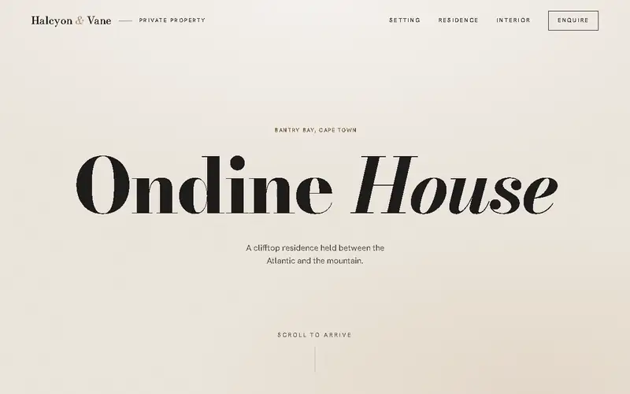
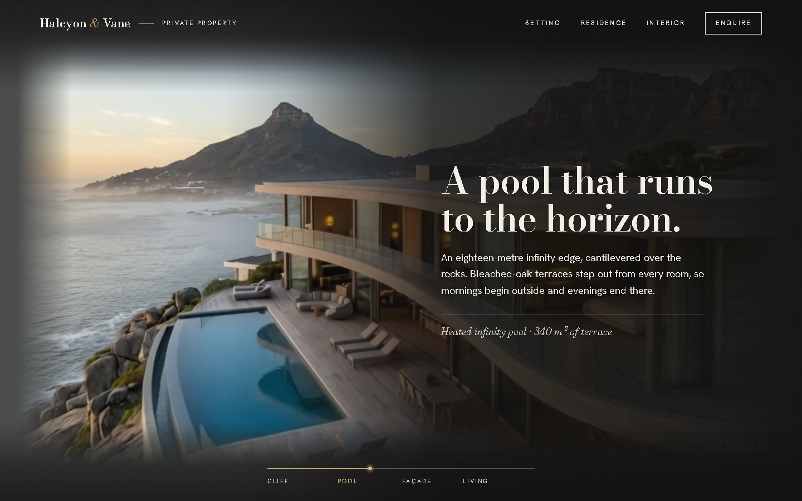
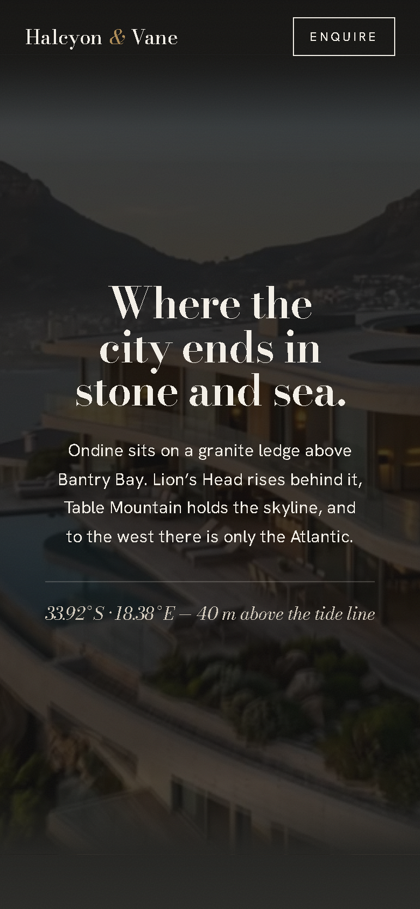

# Ondine House

A scroll-driven landing page for a fictional clifftop house in Cape Town. As you scroll,
a single drone shot plays frame by frame on a canvas: from the cliff edge, over the
infinity pool, through curved glass doors and into the living room. Editorial copy,
counters and a closing call to action are timed to what the camera is passing.
Plain HTML, CSS and JavaScript, with no build step.

**View it:** <https://momonimome.github.io/ondine-house/>







## Features

- **Scroll-scrubbed video:** 121 frames drawn on a canvas. Scrolling down plays the flight
  forwards; scrolling up plays it in exact reverse, because every scroll position maps to
  one frame.
- **Smooth playback:** neighbouring frames are crossfaded by the fractional position, so
  121 frames glide across 9,000 pixels of scroll. Lenis smooths the wheel input.
- **Story timed to the footage:** a monotone cubic curve maps scroll to video, so each
  section sits over what it describes, and the final frame holds under the closing CTA.
- **Choreographed sections:** a circle wipe opens the hero, each section has its own GSAP
  entrance, stats count up over a dark overlay, and an oversized marquee slides past.
  A brass gauge at the bottom tracks the drone from Cliff to Living.
- **Readable everywhere:** text sits in side zones over gradient scrims and passes WCAG AA
  against the real video pixels. Body copy is never smaller than 1.05rem on desktop.
- **Responsive:** phones get centred text over a dark scrim, a shorter page and a lighter
  set of 90 frames at 960px.
- **Reduced motion:** honours `prefers-reduced-motion` with native scrolling and fades only.
- **No flashes:** every frame is downloaded and decoded before the loader lifts.

## Run it

```sh
npm start            # http://localhost:8000/
```

There are no dependencies to install and no build step. Any static file server pointed at
the repository root works; opening `index.html` straight from disk does not, because the
browser blocks the frame images over `file://`.

## Test

```sh
npm test                       # all four profiles
node test/scroll.test.js mobile    # or just one: desktop, mobile, narrow, reduced
```

The test drives an installed Chrome through the DevTools Protocol. It needs Node 22 or
later and no npm packages; set `CHROME_PATH` if Chrome is not in its usual place.

| Script                 | What it does                                                    |
| ---------------------- | --------------------------------------------------------------- |
| `npm start`            | Serve the site at <http://localhost:8000/>                      |
| `npm test`             | End-to-end scroll test at 1440px, 390px, 375px and reduced motion |
| `npm run screenshots`  | Regenerate the screenshots and the WebP/MP4 previews in `docs/`  |
| `npm run frames -- <video>` | Re-extract `frames/` and `frames-mobile/` from a video with FFmpeg |

The last two need FFmpeg; set `FFMPEG_PATH` if it is not on your `PATH`.

## Test results

`npm test` on the development machine (Node 24.22, Chrome, Windows 11): **116 checks,
all passing** across four profiles.

| Profile                  | Frames | Forward / reverse                         | Tightest text contrast |
| ------------------------ | -----: | ----------------------------------------- | ---------------------: |
| Desktop 1440 × 900       |    121 | 15 positions revisited, 0 pixel mismatches |  6.01:1 (needs 4.5:1) |
| Phone 390 × 844 (2×)     |     90 | 41 positions revisited, 0 pixel mismatches |  5.85:1 |
| Small phone 375 × 667    |     90 | 41 positions revisited, 0 pixel mismatches |  5.87:1 |
| Desktop, reduced motion  |    121 | 14 positions revisited, 0 pixel mismatches |  6.01:1 |

- **Frame for frame:** each position sampled while scrolling down is revisited in reverse
  order, and the canvas is hashed both times. Every pair is identical.
- **Direction:** with real wheel input, the video never steps backwards on the way down
  (535 display frames) or forwards on the way up. The median step is 0.10 of a source
  frame per display frame, which is why it glides.
- **Sections:** each of the six sections is caught mid-entrance 160 ms after its trigger,
  the stats count up to 6 · 7 · 1,240 · 2,850 · 12, and the CTA stays on screen over the
  final frame.
- **Contrast:** for every visible text block, the test hides the text, screenshots what is
  behind it, and compares the text colour with the 99th-percentile brightest pixel there.
- **Also:** the loader never lifts before every frame has decoded, there is no horizontal
  scroll, and there are no console errors.

## How it works

```
index.html     loader, header, hero, canvas, scrims, overlay, marquee, seven sections
css/style.css  palette and type tokens, layout zones, scrims, mobile and reduced motion
js/app.js      preloader, scroll→frame curve, canvas renderer, section timelines
frames/        121 WebP frames, 1280px (7.9 MB)
frames-mobile/ 90 WebP frames, 960px (3.6 MB)
test/          static server, DevTools driver, scroll test, screenshot and frame tools
```

[docs/ARCHITECTURE.md](docs/ARCHITECTURE.md) explains the decisions: why the video follows
keyframes rather than a constant speed, how the crossfade works, how the scrims keep text
readable, and two traps in testing canvas pages with headless Chrome.

## Built with

HTML, CSS and JavaScript · Canvas 2D · [GSAP](https://gsap.com) with ScrollTrigger ·
[Lenis](https://lenis.darkroom.engineering) · FFmpeg · Bodoni Moda and Hanken Grotesk from
Google Fonts · Node.js and the Chrome DevTools Protocol for testing.

## Licence

The code is MIT ([LICENSE](LICENSE)). The video frames come from an AI-generated clip made
with Kling AI and are not covered by that licence. The agency, the house, the people and
the price are all fictional. [NOTICE](NOTICE) has the details and the third-party credits.
